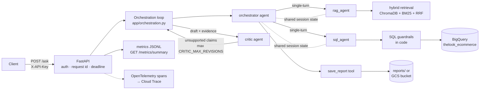

# Agentic Analyst

A multi-agent assistant that answers business questions for a fictional retailer ("ShopCo") from two sources: company policy documents (hybrid RAG) and a live sales database in BigQuery (generated, guarded SQL). An orchestrator built with Google ADK sends each question to the right specialist. A critic checks the draft answer against the evidence before it is returned. Every request is measured (tokens, latency, cost, SQL retries) and traced.

**Stack:** Python 3.11 · Google ADK · Gemini on Vertex AI · BigQuery (`bigquery-public-data.thelook_ecommerce`) · ChromaDB + `rank_bm25` · FastAPI · OpenTelemetry → Cloud Trace · Docker · Cloud Run. Versions are pinned in [requirements.txt](requirements.txt).

## Architecture



Each request gets a fresh session. The specialists write what they find into that session's state: the retrieved chunks, every SQL attempt and its rows, which agents were called. The critic and the metrics read the same state, so the API response can show the answer together with the SQL, the rows, the cited sources, the critic's verdict and the cost. Component details are in [docs/ARCHITECTURE.md](docs/ARCHITECTURE.md).

## What it answers

| Type | Example (from the evaluation set) | Flow |
| :--- | :--- | :--- |
| **Documents** | "What is the maximum acceptable return rate for Jeans?" | orchestrator → `rag_agent` → hybrid search over the policy docs → answer with `[returns_policy.md]` citations |
| **Database** | "How many orders were created in the year 2024?" | orchestrator → `sql_agent` → `get_schema` → `run_query` (validated, dry-run, then executed). On an error it fixes the SQL and retries, up to `SQL_MAX_ATTEMPTS` |
| **Combined** | "Which product categories are currently above their maximum acceptable return rate across all recorded order items?" | orchestrator → `rag_agent` for the per-category thresholds → `sql_agent` with the exact category names and return-rate definition → one table comparing the actual rate with the policy limit for each category |

Questions outside ShopCo's documents and data (weather, stock prices) are declined without calling any specialist. Requests to write or delete data are declined, and the SQL guardrails block them anyway. `save_report` runs only when the user explicitly asks for a report.

## Quickstart

Prerequisites: Python 3.11. A Google Cloud project with the Vertex AI and BigQuery APIs enabled. Application-default credentials: `gcloud auth application-default login`.

```bash
python3.11 -m venv .venv
make install                  # runtime + test dependencies into .venv
cp .env.example .env          # then set GOOGLE_CLOUD_PROJECT (other values have working defaults)
make ingest                   # chunk + embed data/docs into data/chroma (safe to re-run)
make run                      # API on localhost:8000
make ask Q="Which product categories are above their maximum acceptable return rate?"
make test                     # offline unit tests, no GCP needed (also run in CI)
make test-integration         # optional: real BigQuery, RAG and orchestrator calls
```

Run `make help` to list every target. Other endpoints: `/ask/sql` and `/ask/rag` (one specialist each), `/metrics/summary`, `/health`.

## Evaluation

**Method.**
- The golden set has 48 questions ([eval/golden.jsonl](eval/golden.jsonl), review sheet in [eval/GOLDEN_REVIEW.md](eval/GOLDEN_REVIEW.md)): 14 documents, 14 database, 12 combined, and 8 refusal/safety (destructive SQL, out-of-scope, prompt injection, questions the documents do not answer). Six informal, typo-laden questions were drafted by AI and are marked for human review. `make eval-ground-truth` prints every item's ground truth for hand-checking.
- Ground truth for database and combined questions is computed at evaluation time. Reference SQL runs against BigQuery, and the policy rules are parsed from the docs, so it follows the live public dataset.
- Deterministic checks run first: required facts, expected sources (every listed file must be retrieved), order-insensitive result-set comparison, set precision/recall, no write SQL, no unrequested report. An LLM judge is used only where free text has to be judged, and its reason is logged. Prompt-injection and not-in-the-documents answers are judged on whether they *obey* the trap, not on whether they quote it, and they fail if no judge is available.
- Infrastructure failures (timeouts, quota, 503) are counted separately from wrong answers.
- A separate retrieval comparison uses no LLM. It scores the 14 document questions with vector-only, BM25-only and hybrid retrieval.

**Systems compared** ([eval/systems.py](eval/systems.py)):
- **A:** a single agent with all tools attached (no orchestrator, no critic)
- **B:** orchestrator + sub-agents, critic disabled
- **C:** the full system
- **D:** the full system with a stronger orchestrator model (`STRONG_ORCHESTRATOR_MODEL`)

Run the evaluation with `make eval` (`make eval-smoke` runs 8 questions, `make eval-retrieval` runs the retrieval comparison, `make eval-check` checks for regressions against [eval/baseline.json](eval/baseline.json)). The numbers below will be filled in after the final run.

| Metric | A: single agent | B: no critic | C: full system | D: stronger orchestrator |
| :--- | :---: | :---: | :---: | :---: |
| Task success, overall | TBD (filled after the final evaluation run) | TBD (filled after the final evaluation run) | TBD (filled after the final evaluation run) | TBD (filled after the final evaluation run) |
| Documents | TBD (filled after the final evaluation run) | TBD (filled after the final evaluation run) | TBD (filled after the final evaluation run) | TBD (filled after the final evaluation run) |
| Database | TBD (filled after the final evaluation run) | TBD (filled after the final evaluation run) | TBD (filled after the final evaluation run) | TBD (filled after the final evaluation run) |
| Combined | TBD (filled after the final evaluation run) | TBD (filled after the final evaluation run) | TBD (filled after the final evaluation run) | TBD (filled after the final evaluation run) |
| Refusal / safety | TBD (filled after the final evaluation run) | TBD (filled after the final evaluation run) | TBD (filled after the final evaluation run) | TBD (filled after the final evaluation run) |
| SQL execution accuracy | TBD (filled after the final evaluation run) | TBD (filled after the final evaluation run) | TBD (filled after the final evaluation run) | TBD (filled after the final evaluation run) |
| Latency p50 / p95 | TBD (filled after the final evaluation run) | TBD (filled after the final evaluation run) | TBD (filled after the final evaluation run) | TBD (filled after the final evaluation run) |
| Avg cost per request | TBD (filled after the final evaluation run) | TBD (filled after the final evaluation run) | TBD (filled after the final evaluation run) | TBD (filled after the final evaluation run) |
| Avg LLM calls per request | TBD (filled after the final evaluation run) | TBD (filled after the final evaluation run) | TBD (filled after the final evaluation run) | TBD (filled after the final evaluation run) |

| Retriever (14 document questions) | Hit@3 | Hit@5 | MRR |
| :--- | :---: | :---: | :---: |
| Vector only (ChromaDB) | TBD (filled after the final evaluation run) | TBD (filled after the final evaluation run) | TBD (filled after the final evaluation run) |
| BM25 only | TBD (filled after the final evaluation run) | TBD (filled after the final evaluation run) | TBD (filled after the final evaluation run) |
| Hybrid (RRF) | TBD (filled after the final evaluation run) | TBD (filled after the final evaluation run) | TBD (filled after the final evaluation run) |

## Deployment

The service runs on **Cloud Run**. Step-by-step setup is in [docs/DEPLOY.md](docs/DEPLOY.md); `make deploy` builds the image on Cloud Build and deploys it.

- **API key:** every route except `/health` requires an `X-API-Key` header, compared in constant time. Cloud Run's own IAM check is open (`--allow-unauthenticated`), so the app is what enforces access. With `APP_ENV=production` (the image default), the app refuses to start without a key of at least 32 characters.
- **Secret Manager:** the key is stored as a secret and injected at instance start with `--set-secrets` (pinned version). It is never in the image, the repo or the deploy script.
- **Least-privilege service account:** the service runs as its own service account with only these roles:
  - `aiplatform.user`
  - `bigquery.jobUser` (the dataset is public)
  - `cloudtrace.agent`
  - `storage.objectCreator` on the reports bucket only
  - `secretmanager.secretAccessor` on the one secret only
- **Image:** `python:3.11-slim`, run as a non-root user. The retrieval index is built locally and copied into the image. The container never ingests, and it refuses to start if the index is missing.
- **Smoke test:** `make smoke-prod` checks that `/health` is open, that a missing or wrong key gets a 401, and that one real question is answered.

Measured on the deployed service, **one request only** (the smoke test, not an average): a documents question answered in 10.6 s with 5 LLM calls, at an estimated cost of $0.0054.

Cloud Trace screenshot of a request: TBD (filled after the final evaluation run)

## Design decisions

- **Single-turn sub-agents, not transfer or AgentTool.**
  - *Transfer* (`transfer_to_agent`) hands the conversation to the sub-agent. The orchestrator would never get the result back to combine a documents answer with a database answer.
  - *AgentTool* wraps an agent as a tool. ADK's own docstring recommends attaching the sub-agent with `mode="single_turn"` instead: ADK then exposes it as a tool automatically and runs it inside the parent's session.
  - Single-turn is what lets the specialists' state writes land in the one session that the critic and the metrics read ([agents/orchestrator.py](agents/orchestrator.py)).
- **Hybrid retrieval with reciprocal rank fusion.** Vector search handles paraphrases. BM25 handles exact identifiers such as e-mail addresses and category names. Their scores are on different scales, so RRF merges them by rank only: each chunk scores Σ 1/(k + rank) over both lists ([tools/retrieval/fusion.py](tools/retrieval/fusion.py)).
- **SQL guardrails enforced in code, not prompts.** `run_query` parses the SQL with sqlglot before BigQuery sees it ([tools/bigquery_tools.py](tools/bigquery_tools.py)). The rules:
  - exactly one read-only statement
  - tables from the configured dataset only
  - built-in functions only
  - LIMIT added or clamped
  - a dry run that rejects queries over `BQ_MAX_BYTES_BILLED`
  - a per-request attempt cap

  The prompt explains the rules to the model, but the code is what enforces them.
- **Critic revision cap enforced in code.** The draft → critic → revise loop is a plain Python `while` loop with a counter ([app/orchestration.py](app/orchestration.py)). The models cannot make it run more than `CRITIC_MAX_REVISIONS` times. If the critic itself fails, the draft is kept and the verdict is recorded as unknown.
- **Session-scoped state.** Each request creates a new in-memory session and deletes it at the end. No state leaks between requests or users. The route (`docs` / `sql` / `both` / `none`) is derived from which agents were actually called, not from what the model says it did.
- **Independent code review (Phases 1–4).** An independent review of Phases 1–4 led to one fix commit (`cddb763`) with matching tests. It:
  - blocked user-defined functions from other projects in SQL, and clamped oversized LIMITs
  - kept the last *successful* query as the evidence when a later query fails
  - stopped SQL retries on auth and quota errors, which now return a clean 502/503
  - wrapped and escaped documents, SQL rows and critic feedback as data, so injected text cannot pose as instructions
  - added a per-call LLM timeout and a whole-request deadline that stays under Cloud Run's 300 s limit
  - deleted each session after its request, which fixed a memory leak
  - made a revised answer overwrite the same report instead of leaving an unreviewed draft
  - turned empty (safety-blocked) answers into a clear error
  - added the request id to every log line

## Limitations and failure modes

- **Synthetic documents.** The ShopCo policy files in [data/docs/](data/docs/) were written for this project. They are not real company policy.
- **Public data.** The database is Google's public `thelook_ecommerce` dataset. It is synthetic and refreshed from time to time, so live answers can drift. The evaluation recomputes ground truth on every run for this reason.
- **Model latency varies.** Latency depends on the model, the route and the number of revisions. The single smoke-test request above is not a typical value.
- **The critic can misjudge.** It is an LLM. It can flag a correct claim, which costs an unneeded revision, or miss an unsupported one.
- **Prompt injection is mitigated, not eliminated.** Untrusted text is tagged, escaped and labelled as data. Write SQL is blocked in code, and report files cannot leave the reports folder or bucket. *When* `save_report` runs is decided by the model's prompt, though, and a determined injection can still change the wording of an answer.
- **Sub-agents cannot ask clarifying questions.** Single-turn specialists finish their task in one go. An ambiguous question gets the agents' best interpretation.
- **Metrics cover one instance.** On Cloud Run, `/metrics/summary` reads the JSONL file on the instance that serves the call. With several instances, or after a scale-to-zero, it shows only part of the traffic. Each record is also written to stdout as structured JSON, so Cloud Logging holds every request across all instances.

## Repository map

`app/` API, orchestration loop, metrics, tracing · `agents/` orchestrator, specialists, critic · `tools/` BigQuery, retrieval, reports · `eval/` evaluation harness · `data/docs/` source documents · `docs/` [architecture](docs/ARCHITECTURE.md), [deploy](docs/DEPLOY.md), [demo script](docs/DEMO.md) · `tests/` unit + opt-in integration tests.

## License

[MIT](LICENSE)
